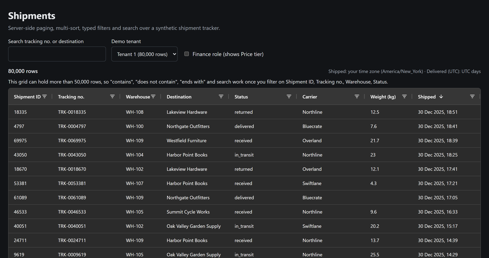

<div align="center">

# Server-side grid framework

**One contract, one column allow-list and one SQL builder for every server-side grid.**

**[Read the case study →](https://the3ma.github.io/server-side-grid-framework/)** - what it replaced, the architecture, six ADRs and the trade-offs.



<sub>The Angular sample over 80,000 synthetic shipments, shown with <code>npm run start:mock</code>.</sub>

[](https://github.com/the3ma/server-side-grid-framework/actions/workflows/ci.yml)


[](LICENSE)

</div>

---

A reference implementation of server-side paging, multi-sort and typed filtering for data grids in a
regulated product, generalized from production work. A grid declares its columns once on each side
and gets paging, up to three sorts, five filter types, server-side set values, quick search, a
large-dataset guard, cancellation and typed errors, without writing SQL builders or request mappers.

## What it guarantees

- **Safe by construction.** No request value ever becomes SQL text. Fields, operators and sort
  directions resolve only through the grid's allow-list; every value is a generated, bound parameter.
- **Row scope only narrows.** The feature's base query, with the caller's row scope bound from the
  authenticated identity, is wrapped as a derived table; filters are applied outside it.
- **Large datasets protected.** On a guarded grid, `contains`, `notContains`, `endsWith` and search are
  refused on the server until an indexed filter narrows the set, and the UI explains why.
- **Never an empty grid on failure.** Four typed, value-free ProblemDetails; an inline banner with
  "Try again" in the UI.
- **Honest numbers.** `totalCount` is `null` when not counted, never `0`; a malformed page is an error.
- **Same behaviour on SQL Server and Oracle**, plus SQLite for the runnable demo.
- **Restricted columns fail closed.**

## Repository layout

| Path | What |
|---|---|
| `src/GridKit/` | The framework: contract, column map, guard, dates, SQL builder, dialects (SQL Server, Oracle, SQLite), executor, ProblemDetails, manifest |
| `src/SampleApi/` | ASP.NET Core sample: `POST /api/shipments/grid` and `/grid/values` over a seeded SQLite file |
| `tests/GridKit.Tests/` | xUnit: guard and limits, SQL snapshots for all three dialects (including injection attempts), dates and DST, executor errors, manifest, API integration |
| `web/` | Angular 20 sample: column declaration, request mapping, data source, `<gk-server-grid>` on AG Grid Community, set filter, mock backend; Vitest |
| `docs/CONTRACT.md` | The request/response contract both sides implement |
| `docs/adr/` | Six architecture decision records |
| `docs/manifest/` | The column map as SQL-free JSON, written by the backend tests and checked by the frontend tests |
| `docs/index.html` | The case study (GitHub Pages) |

## Quick start

```bash
dotnet test                            # 108 tests
dotnet run --project src/SampleApi     # http://localhost:5080, seeds 120,000 shipments on first start
cd web && npm ci && npm start          # http://localhost:4200, proxies /api to the sample API
```

No .NET SDK? `cd web && npm ci && npm run start:mock` runs the UI against an in-memory backend with
the same allow-list, guard and null-total rules.

The demo signs every request in as tenant 1. The page's tenant switch and Finance role toggle send
`X-Demo-Tenant` and `X-Demo-Finance` headers, which only the demo authentication handler reads. A
real deployment takes both from the identity provider.

## Declaring a grid

Backend: the allow-list.

```csharp
public static readonly GridColumnMap<ShipmentRow> Map = GridColumnMap<ShipmentRow>
    .Create("shipments", "g.ShipmentId")                              // grid id + unique tiebreaker
    .Number("shipmentId", "g.ShipmentId", c => c.Sortable().Filterable().Indexed())
    .Text("trackingNo", "g.TrackingNo", c => c.Sortable().Filterable().Searchable().Indexed().StoredUpperCase())
    .Set("status", "g.Status", c => c.Sortable().Filterable().Indexed())
    .Date("shippedOn", "g.ShippedAt", GridDateSemantics.Local, c => c.Sortable().Filterable())
    .Date("deliveredOn", "g.DeliveredAt", GridDateSemantics.Utc, c => c.Sortable().Filterable())
    .Set("priceTier", "g.PriceTier", c => c.Filterable().Restricted())
    .DefaultSortBy("shippedOn", descending: true)
    .GuardScanFilters(50_000);
```

Frontend: the same columns, as AG Grid column definitions and request-mapping specs.

```ts
export const SHIPMENTS_GRID = defineGridColumns<ShipmentRow>({
  grid: 'shipments',
  largeDatasetThreshold: 50_000,
  columns: [
    gridColumn({ field: 'trackingNo', type: 'text', headerName: 'Tracking no.',
      sortable: true, filterable: true, searchable: true, indexed: true }),
    gridColumn({ field: 'status', type: 'set', headerName: 'Status',
      sortable: true, filterable: true, indexed: true }),
    gridColumn({ field: 'shippedOn', type: 'date', headerName: 'Shipped',
      sortable: true, filterable: true, dateSemantics: 'local' }),
  ],
});
```

The two declarations are compared in CI: the backend writes `docs/manifest/shipments.json` and the
frontend test fails when its declaration differs.

## Documentation

- [Case study](https://the3ma.github.io/server-side-grid-framework/)
- [Grid contract](docs/CONTRACT.md)
- ADRs: [0001 column allow-list](docs/adr/0001-column-allow-list.md) ·
  [0002 server-side guard](docs/adr/0002-large-dataset-guard-on-the-server.md) ·
  [0003 filters only narrow](docs/adr/0003-filters-only-narrow-the-row-scope.md) ·
  [0004 typed errors](docs/adr/0004-typed-errors-never-an-empty-grid.md) ·
  [0005 date semantics](docs/adr/0005-date-semantics-belong-to-the-column.md) ·
  [0006 null total, strict pages](docs/adr/0006-null-total-and-strict-pages.md)

## Related

Exporting a server-side grid needs its own path, because the browser only ever holds one page. That
is the companion case study: [Async export pipeline](https://the3ma.github.io/async-export-pipeline/)
([source](https://github.com/the3ma/async-export-pipeline)), an export as a streamed, audited job.

## Scope

The SQL Server and Oracle dialects are covered by SQL-text and parameter snapshots and by simulated
driver errors; only the SQLite dialect runs against a real database in this repository. The sample
uses synthetic data; the employer, client and product the pattern comes from are not named.

## License

[MIT](LICENSE)
